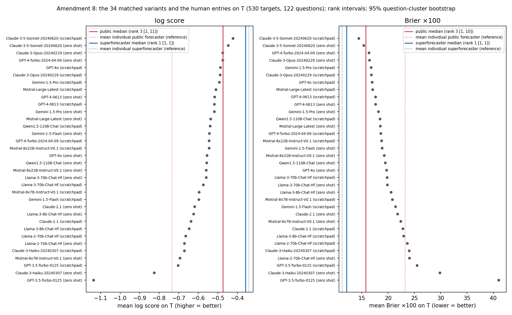
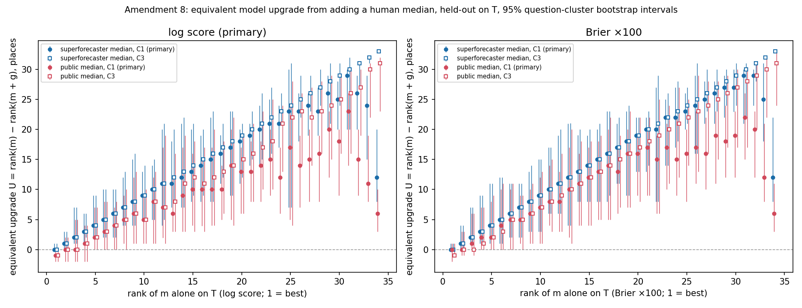

# SPEC v3 Amendment 8: leaderboard levels and equivalent model upgrade

Spec: `80236ad105365ba1d8cb896830ff6dc0bf84122b` (specs/forecast_spec_v3.md, Amendment 8 with its pre-run clarifications, committed before this code was written or run). Repo HEAD at run: `80236ad105365ba1d8cb896830ff6dc0bf84122b` (working tree has uncommitted files: this script and its outputs). No v1, v2, P5 or Amendment 6/7 number changes.

## |T|

- |T| = **530 targets on 122 questions** (of 578 targets and 162 questions in the v1 H1 frame): targets where all 34 variants have non-imputed forecasts and both group medians exist. Both medians exist on all 578 targets, so T is the set where all 34 variants are non-imputed (530). |T| ≥ 300, so the larger-set leaderboard is not required and is not reported.

## Reproduction check

Amendment 7's G_B(M1) recomputed on the Amendment 8 item 2 rows for M1 (every row where M1 is non-imputed; clarification 1). M1 has no imputed rows, so the row sets coincide with Amendment 7's. Same bootstrap draws (seed 20260906, 2000 draws). Match tolerance: the 6 decimals stored in `docs/amendment7_pervariant.csv`.

| group | rows (A8 / A7) | Amendment 8 | Amendment 7 | match |
|---|---|---|---|---|
| S | 4,797 / 4,797 | +3.3826 [+1.5248, +5.6180] | +3.3826 [+1.5248, +5.6180] | yes |
| P | 28,537 / 28,537 | -7.8091 [-9.6605, -5.8244] | -7.8091 [-9.6605, -5.8244] | yes |

## Setup

- Frame: `data/derived/full_frame.pkl` (33,334 forecaster-target rows, 578 targets, 162 questions; v1 Amendment 2 exclusions). Variant forecasts: the 34 matched variants via the v1 loader, non-imputed only.
- Scores: Brier ×100; log score with probabilities clipped to [0.01, 0.99]. Leaderboard scores are reported as mean Brier ×100 (lower = better) and mean log score (higher = better). Every gain is a loss difference "score(x) − score(y)" with Brier and log loss as the losses, so positive means y is better. Log score is primary and Brier is beside it (clarification 3).
- Intervals: question-level cluster bootstrap, 2000 draws, seed 20260906, percentile 95%; the draws are Amendment 7's, and one set serves every quantity in items 1–3. Questions with no target in T contribute nothing to an item 1 or item 3 draw.
- Folds (item 3): Amendment 6's assignment (5 folds by question, seed 20260908, v2 cross-fit rule), assigned on all 578 targets and restricted to T, so each question keeps its Amendment 6 fold. In each bootstrap draw the folds are reassigned on the draw's clusters with the same rule and C3 is refit (clarification 4).
- Combiners: C1 = (p + q)/2. C3 = w·g + (1 − w)·m, w ∈ [0, 1] on the human median, closed-form training-fold Brier minimum then clipped (Amendment 6 `fit_c3`), fit on T targets in the training folds and frozen on the test fold.
- Two orderings (clarification 2). Selection-set Q (v1 §4 Brier on the 930-target selection set; the Figure 1 order) orders the three anchor variants and sets item 2's threshold. Score on T, separately per rule, orders variants for ranks, U, F and "best variant" in items 1 and 3. Spearman correlation between selection-set Q and the score-on-T order: log score ρ = 0.862, Brier ρ = 0.909 (34 variants; both orderings are losses, so positive ρ means agreement).
- Ranks: 1 + the number of the 34 variants with strictly lower mean loss on T (ties share the better rank).

Choices not fixed by the spec, made here and flagged:
- Median-ranked anchor variant: 34 is even; the anchor is Q rank 17 (Mixtral-8x7B-Instruct-V0.1 (zero shot)).
- F's denominator uses the best variant identified at the point estimate (per rule), held fixed across draws; U is recomputed from re-ranked variants in every draw. For variants whose loss is close to the best variant's, F's denominator is near zero and its interval is wide or unbounded; those intervals are reported as computed.
- C3 weight-stability rule applied over all 68 (variant, median) pairs: C3 is descriptive only if any of them has a fold-to-fold weight SD above 0.2.
- Item 2 "share of forecasters helped" uses each forecaster's own mean of score(m) − score(A) over their rows for m (at least 10), per rule; no interval (none specified).
- Item 2 threshold X: the best Q rank whose gain-over-AI interval lies entirely above zero. Variants with worse Q rank whose interval does not lie above zero are listed as exceptions, since the sentence "at or below rank X" claims all of them.

## Locked reading (restated)

- All three items are descriptive readouts for Section 10. No new hypothesis test, no per-variant p-values. 34 variants are not 34 tests.
- Recorded expectation (before the run): the superforecaster median ranks above every variant; the public median ranks in the lower half; averaging helps the public against weaker models only; for the public median, U is near zero for the top variant and positive for low-ranked variants.
- If log score and Brier disagree on a readout, report both and state the disagreement in one sentence.

## Recorded expectation, checked

- log score: superforecaster median rank 1 [1, 1] of 35 (above every variant; expectation met); public median rank 3 [2, 11] of 35 (upper half; expectation not met; lower half = rank 18–35).
- Brier ×100: superforecaster median rank 1 [1, 1] of 35 (above every variant; expectation met); public median rank 3 [1, 10] of 35 (upper half; expectation not met; lower half = rank 18–35).
- log score: averaging helps the public (interval above zero) against 12 of 34 variants; the best Q rank among them is 17; 6 variants at worse Q ranks do not have an interval above zero.
- Brier ×100: averaging helps the public (interval above zero) against 12 of 34 variants; the best Q rank among them is 17; 6 variants at worse Q ranks do not have an interval above zero.
- log score, public median, C1: U for the top variant on T (Claude-3-5-Sonnet-20240620 (scratchpad)) = -1 [-2, +0]; U for the 7 lowest-ranked variants on T (ranks 28–34): +16, +20, +18, +23, +15, +11, +6.
- Brier ×100, public median, C1: U for the top variant on T (Claude-3-5-Sonnet-20240620 (scratchpad)) = +0 [-2, +1]; U for the 7 lowest-ranked variants on T (ranks 28–34): +19, +18, +19, +22, +20, +12, +6.

## Log score and Brier disagreements

- None on the human-median ranks, the item 2 thresholds, the sign of U at the three anchors, or the best variant.

## Item 1. Leaderboard of levels on T (researcher)

Entries scored on T (530 targets). Human medians: rank among the 34 variants plus the entry, with 95% bootstrap rank interval. Mean individual forecasters are a reference line only (mean over that group's forecaster-target rows on T: S 4,101 rows, P 26,175 rows); their rank is shown for orientation, without an interval.

| entry | log score | rank [95% CI] | Brier ×100 | rank [95% CI] |
|---|---|---|---|---|
| superforecaster median | -0.359 | 1 [1, 1] | 12.10 | 1 [1, 1] |
| public median | -0.475 | 3 [2, 11] | 15.75 | 3 [1, 10] |
| mean individual superforecaster (reference) | -0.341 | (1) | 11.24 | (1) |
| mean individual public forecaster (reference) | -0.735 | (33) | 23.22 | (29) |

The 34 variants on T, in selection-set Q order:

| Q rank | variant | Q | log score | rank on T | Brier ×100 | rank on T |
|---|---|---|---|---|---|---|
| 1 | Claude-3-5-Sonnet-20240620 (zero shot) | 0.1616 | -0.447 | 2 | 15.33 | 2 |
| 2 | Claude-3-5-Sonnet-20240620 (scratchpad) | 0.1634 | -0.423 | 1 | 14.40 | 1 |
| 3 | GPT-4-Turbo-2024-04-09 (zero shot) | 0.1756 | -0.475 | 4 | 16.33 | 3 |
| 4 | Claude-3-Opus-20240229 (scratchpad) | 0.1773 | -0.489 | 6 | 16.81 | 6 |
| 5 | GPT-4-Turbo-2024-04-09 (scratchpad) | 0.1776 | -0.545 | 15 | 18.61 | 14 |
| 6 | Gemini-1.5-Pro (scratchpad) | 0.1779 | -0.494 | 7 | 16.72 | 5 |
| 7 | Qwen1.5-110B-Chat (scratchpad) | 0.1818 | -0.540 | 13 | 18.46 | 12 |
| 8 | Claude-3-Opus-20240229 (zero shot) | 0.1836 | -0.475 | 3 | 16.44 | 4 |
| 9 | GPT-4o (scratchpad) | 0.1875 | -0.488 | 5 | 16.93 | 7 |
| 10 | GPT-4-0613 (zero shot) | 0.1877 | -0.517 | 9 | 17.58 | 10 |
| 11 | Llama-3-8b-Chat-Hf (zero shot) | 0.1918 | -0.625 | 25 | 20.52 | 22 |
| 12 | Qwen1.5-110B-Chat (zero shot) | 0.1920 | -0.557 | 18 | 19.42 | 18 |
| 13 | GPT-4-0613 (scratchpad) | 0.1937 | -0.519 | 10 | 17.57 | 9 |
| 14 | Gemini-1.5-Pro (zero shot) | 0.1986 | -0.519 | 11 | 18.12 | 11 |
| 15 | Mistral-Large-Latest (scratchpad) | 0.1989 | -0.511 | 8 | 17.06 | 8 |
| 16 | Mixtral-8x22B-Instruct-V0.1 (scratchpad) | 0.1991 | -0.546 | 16 | 18.74 | 15 |
| 17 | Mixtral-8x7B-Instruct-V0.1 (zero shot) | 0.2006 | -0.695 | 31 | 22.41 | 26 |
| 18 | Mixtral-8x22B-Instruct-V0.1 (zero shot) | 0.2053 | -0.560 | 19 | 19.24 | 17 |
| 19 | GPT-4o (zero shot) | 0.2064 | -0.557 | 17 | 19.68 | 19 |
| 20 | Mistral-Large-Latest (zero shot) | 0.2072 | -0.537 | 12 | 18.47 | 13 |
| 21 | Llama-3-70b-Chat-Hf (zero shot) | 0.2075 | -0.560 | 20 | 19.85 | 21 |
| 22 | Llama-3-70b-Chat-Hf (scratchpad) | 0.2077 | -0.575 | 21 | 19.76 | 20 |
| 23 | Gemini-1.5-Flash (scratchpad) | 0.2091 | -0.597 | 23 | 21.39 | 24 |
| 24 | Claude-2.1 (zero shot) | 0.2093 | -0.619 | 24 | 21.77 | 25 |
| 25 | Gemini-1.5-Flash (zero shot) | 0.2136 | -0.544 | 14 | 18.86 | 16 |
| 26 | Mixtral-8x7B-Instruct-V0.1 (scratchpad) | 0.2310 | -0.597 | 22 | 20.78 | 23 |
| 27 | Llama-3-8b-Chat-Hf (scratchpad) | 0.2353 | -0.647 | 27 | 22.94 | 28 |
| 28 | Claude-2.1 (scratchpad) | 0.2431 | -0.638 | 26 | 22.80 | 27 |
| 29 | Claude-3-Haiku-20240307 (scratchpad) | 0.2435 | -0.672 | 30 | 23.98 | 30 |
| 30 | Llama-2-70b-Chat-Hf (scratchpad) | 0.2501 | -0.665 | 28 | 23.62 | 29 |
| 31 | Llama-2-70b-Chat-Hf (zero shot) | 0.2582 | -0.672 | 29 | 24.06 | 31 |
| 32 | GPT-3.5-Turbo-0125 (scratchpad) | 0.2642 | -0.703 | 32 | 25.48 | 32 |
| 33 | Claude-3-Haiku-20240307 (zero shot) | 0.2841 | -0.826 | 33 | 29.84 | 33 |
| 34 | GPT-3.5-Turbo-0125 (zero shot) | 0.3974 | -1.136 | 34 | 41.00 | 34 |

## Item 2. Averaging rule for an individual (person)

A = (h + m)/2 for each forecaster-target row where m is non-imputed (clarification 1). Gain vs AI = score(m) − score(A); gain vs own = score(h) − score(A); positive = averaging is better. Log gains in natural units, Brier ×100.

Threshold readout (Q rank; "averaging your forecast with the model helps against models at or below rank X"):

| group | rule | X | variant at X | variants with interval above zero | exceptions at worse Q ranks |
|---|---|---|---|---|---|
| S | log score | 1 | Claude-3-5-Sonnet-20240620 (zero shot) | 34 | none |
| S | Brier ×100 | 1 | Claude-3-5-Sonnet-20240620 (zero shot) | 34 | none |
| P | log score | 17 | Mixtral-8x7B-Instruct-V0.1 (zero shot) | 12 | Mixtral-8x22B-Instruct-V0.1 (zero shot), GPT-4o (zero shot), Mistral-Large-Latest (zero shot), Llama-3-70b-Chat-Hf (zero shot), Llama-3-70b-Chat-Hf (scratchpad), Gemini-1.5-Flash (zero shot) |
| P | Brier ×100 | 17 | Mixtral-8x7B-Instruct-V0.1 (zero shot) | 12 | Mixtral-8x22B-Instruct-V0.1 (zero shot), GPT-4o (zero shot), Mistral-Large-Latest (zero shot), Llama-3-70b-Chat-Hf (zero shot), Llama-3-70b-Chat-Hf (scratchpad), Gemini-1.5-Flash (zero shot) |

### Superforecasters

| Q rank | variant | n rows | gain vs AI, log [95% CI] | gain vs own, log [95% CI] | helped, log (n) | gain vs AI, Brier ×100 [95% CI] | gain vs own, Brier ×100 [95% CI] | helped, Brier (n) |
|---|---|---|---|---|---|---|---|---|
| 1 | Claude-3-5-Sonnet-20240620 (zero shot) | 4,797 | +0.076 [+0.040, +0.126] | -0.021 [-0.042, -0.001] | 0.97 (39) | +2.63 [+1.44, +4.12] | -0.76 [-1.52, -0.04] | 0.92 (39) |
| 2 | Claude-3-5-Sonnet-20240620 (scratchpad) | 4,797 | +0.049 [+0.028, +0.072] | -0.009 [-0.027, +0.012] | 0.92 (39) | +1.94 [+1.04, +2.96] | -0.28 [-0.90, +0.35] | 0.90 (39) |
| 3 | GPT-4-Turbo-2024-04-09 (zero shot) | 4,797 | +0.066 [+0.046, +0.089] | -0.026 [-0.046, -0.006] | 0.95 (39) | +2.68 [+1.74, +3.80] | -0.70 [-1.34, -0.08] | 0.92 (39) |
| 4 | Claude-3-Opus-20240229 (scratchpad) | 4,797 | +0.085 [+0.059, +0.114] | -0.033 [-0.057, -0.008] | 0.97 (39) | +3.41 [+2.22, +4.79] | -0.86 [-1.61, -0.11] | 0.97 (39) |
| 5 | GPT-4-Turbo-2024-04-09 (scratchpad) | 4,797 | +0.124 [+0.090, +0.165] | -0.054 [-0.079, -0.026] | 0.97 (39) | +4.69 [+3.35, +6.12] | -1.50 [-2.32, -0.71] | 0.97 (39) |
| 6 | Gemini-1.5-Pro (scratchpad) | 4,797 | +0.089 [+0.066, +0.113] | -0.036 [-0.058, -0.011] | 0.97 (39) | +3.55 [+2.47, +4.70] | -0.80 [-1.43, -0.14] | 0.97 (39) |
| 7 | Qwen1.5-110B-Chat (scratchpad) | 4,797 | +0.114 [+0.090, +0.139] | -0.061 [-0.083, -0.035] | 1.00 (39) | +4.59 [+3.47, +5.79] | -1.53 [-2.17, -0.91] | 0.97 (39) |
| 8 | Claude-3-Opus-20240229 (zero shot) | 4,797 | +0.070 [+0.046, +0.100] | -0.027 [-0.046, -0.007] | 0.97 (39) | +2.85 [+1.84, +4.10] | -0.83 [-1.43, -0.18] | 0.95 (39) |
| 9 | GPT-4o (scratchpad) | 4,797 | +0.082 [+0.059, +0.108] | -0.031 [-0.053, -0.008] | 0.95 (39) | +3.40 [+2.31, +4.57] | -0.97 [-1.71, -0.24] | 0.95 (39) |
| 10 | GPT-4-0613 (zero shot) | 4,797 | +0.094 [+0.066, +0.123] | -0.038 [-0.060, -0.015] | 0.97 (39) | +3.67 [+2.50, +4.91] | -0.90 [-1.63, -0.14] | 0.97 (39) |
| 11 | Llama-3-8b-Chat-Hf (zero shot) | 4,797 | +0.183 [+0.089, +0.309] | -0.051 [-0.081, -0.022] | 1.00 (39) | +5.41 [+3.56, +7.62] | -1.73 [-2.82, -0.75] | 1.00 (39) |
| 12 | Qwen1.5-110B-Chat (zero shot) | 4,797 | +0.113 [+0.089, +0.136] | -0.063 [-0.081, -0.042] | 1.00 (39) | +4.74 [+3.60, +5.89] | -1.67 [-2.23, -1.05] | 0.97 (39) |
| 13 | GPT-4-0613 (scratchpad) | 4,775 | +0.103 [+0.080, +0.125] | -0.051 [-0.073, -0.022] | 0.97 (39) | +4.08 [+3.04, +5.17] | -1.19 [-1.82, -0.52] | 0.97 (39) |
| 14 | Gemini-1.5-Pro (zero shot) | 4,797 | +0.104 [+0.076, +0.134] | -0.046 [-0.068, -0.023] | 1.00 (39) | +4.39 [+3.12, +5.73] | -1.28 [-2.01, -0.55] | 1.00 (39) |
| 15 | Mistral-Large-Latest (scratchpad) | 4,797 | +0.101 [+0.079, +0.123] | -0.049 [-0.072, -0.022] | 1.00 (39) | +3.86 [+2.84, +4.91] | -1.07 [-1.74, -0.36] | 0.97 (39) |
| 16 | Mixtral-8x22B-Instruct-V0.1 (scratchpad) | 4,797 | +0.115 [+0.089, +0.141] | -0.059 [-0.081, -0.034] | 1.00 (39) | +4.73 [+3.50, +5.96] | -1.48 [-2.15, -0.80] | 1.00 (39) |
| 17 | Mixtral-8x7B-Instruct-V0.1 (zero shot) | 4,797 | +0.237 [+0.141, +0.350] | -0.071 [-0.100, -0.044] | 1.00 (39) | +7.11 [+4.91, +9.51] | -2.44 [-3.59, -1.34] | 1.00 (39) |
| 18 | Mixtral-8x22B-Instruct-V0.1 (zero shot) | 4,797 | +0.142 [+0.098, +0.188] | -0.054 [-0.080, -0.027] | 0.97 (39) | +5.17 [+3.52, +6.95] | -1.78 [-2.70, -0.92] | 0.97 (39) |
| 19 | GPT-4o (zero shot) | 4,797 | +0.116 [+0.087, +0.146] | -0.053 [-0.074, -0.030] | 1.00 (39) | +4.95 [+3.60, +6.35] | -1.46 [-2.14, -0.75] | 1.00 (39) |
| 20 | Mistral-Large-Latest (zero shot) | 4,797 | +0.107 [+0.072, +0.145] | -0.043 [-0.068, -0.019] | 0.95 (39) | +3.95 [+2.59, +5.46] | -1.34 [-2.29, -0.45] | 0.95 (39) |
| 21 | Llama-3-70b-Chat-Hf (zero shot) | 4,797 | +0.127 [+0.098, +0.157] | -0.060 [-0.084, -0.034] | 1.00 (39) | +5.42 [+4.03, +6.85] | -1.81 [-2.62, -0.97] | 1.00 (39) |
| 22 | Llama-3-70b-Chat-Hf (scratchpad) | 4,797 | +0.132 [+0.105, +0.160] | -0.070 [-0.095, -0.042] | 1.00 (39) | +5.43 [+4.16, +6.79] | -1.71 [-2.50, -0.87] | 0.97 (39) |
| 23 | Gemini-1.5-Flash (scratchpad) | 4,797 | +0.145 [+0.111, +0.181] | -0.070 [-0.095, -0.042] | 1.00 (39) | +6.11 [+4.59, +7.74] | -2.25 [-3.13, -1.39] | 1.00 (39) |
| 24 | Claude-2.1 (zero shot) | 4,775 | +0.154 [+0.126, +0.179] | -0.091 [-0.112, -0.065] | 1.00 (39) | +6.87 [+5.59, +7.97] | -2.33 [-2.90, -1.62] | 1.00 (39) |
| 25 | Gemini-1.5-Flash (zero shot) | 4,797 | +0.124 [+0.084, +0.171] | -0.048 [-0.071, -0.023] | 1.00 (39) | +4.78 [+3.31, +6.37] | -1.46 [-2.32, -0.60] | 1.00 (39) |
| 26 | Mixtral-8x7B-Instruct-V0.1 (scratchpad) | 4,545 | +0.190 [+0.149, +0.237] | -0.089 [-0.117, -0.058] | 1.00 (39) | +7.56 [+5.96, +9.36] | -2.40 [-3.29, -1.53] | 1.00 (39) |
| 27 | Llama-3-8b-Chat-Hf (scratchpad) | 4,797 | +0.176 [+0.147, +0.204] | -0.096 [-0.123, -0.063] | 1.00 (39) | +7.68 [+6.31, +8.99] | -2.41 [-3.21, -1.57] | 1.00 (39) |
| 28 | Claude-2.1 (scratchpad) | 4,287 | +0.173 [+0.142, +0.204] | -0.094 [-0.125, -0.058] | 1.00 (39) | +7.67 [+6.24, +9.14] | -2.61 [-3.45, -1.69] | 1.00 (39) |
| 29 | Claude-3-Haiku-20240307 (scratchpad) | 4,797 | +0.208 [+0.172, +0.245] | -0.112 [-0.141, -0.081] | 1.00 (39) | +9.02 [+7.37, +10.75] | -3.08 [-4.07, -2.15] | 1.00 (39) |
| 30 | Llama-2-70b-Chat-Hf (scratchpad) | 4,797 | +0.208 [+0.176, +0.241] | -0.118 [-0.146, -0.088] | 1.00 (39) | +9.27 [+7.78, +10.86] | -3.04 [-3.87, -2.25] | 1.00 (39) |
| 31 | Llama-2-70b-Chat-Hf (zero shot) | 4,785 | +0.218 [+0.160, +0.287] | -0.094 [-0.129, -0.058] | 1.00 (39) | +9.27 [+6.77, +12.12] | -2.82 [-4.02, -1.64] | 1.00 (39) |
| 32 | GPT-3.5-Turbo-0125 (scratchpad) | 4,797 | +0.230 [+0.197, +0.264] | -0.125 [-0.153, -0.094] | 1.00 (39) | +10.41 [+8.83, +12.01] | -3.40 [-4.23, -2.53] | 1.00 (39) |
| 33 | Claude-3-Haiku-20240307 (zero shot) | 4,713 | +0.307 [+0.231, +0.392] | -0.139 [-0.176, -0.102] | 1.00 (39) | +12.68 [+9.91, +15.74] | -4.25 [-5.44, -3.10] | 1.00 (39) |
| 34 | GPT-3.5-Turbo-0125 (zero shot) | 4,797 | +0.546 [+0.422, +0.668] | -0.208 [-0.247, -0.163] | 1.00 (39) | +20.72 [+16.65, +24.31] | -7.31 [-8.63, -5.72] | 1.00 (39) |

### Public forecasters

| Q rank | variant | n rows | gain vs AI, log [95% CI] | gain vs own, log [95% CI] | helped, log (n) | gain vs AI, Brier ×100 [95% CI] | gain vs own, Brier ×100 [95% CI] | helped, Brier (n) |
|---|---|---|---|---|---|---|---|---|
| 1 | Claude-3-5-Sonnet-20240620 (zero shot) | 28,537 | -0.041 [-0.063, -0.015] | +0.242 [+0.207, +0.281] | 0.27 (500) | -1.40 [-2.30, -0.44] | +6.41 [+5.37, +7.48] | 0.30 (500) |
| 2 | Claude-3-5-Sonnet-20240620 (scratchpad) | 28,537 | -0.052 [-0.072, -0.030] | +0.249 [+0.216, +0.285] | 0.23 (500) | -1.73 [-2.63, -0.76] | +6.70 [+5.75, +7.66] | 0.27 (500) |
| 3 | GPT-4-Turbo-2024-04-09 (zero shot) | 28,537 | -0.032 [-0.054, -0.008] | +0.228 [+0.190, +0.268] | 0.31 (500) | -1.04 [-2.02, +0.05] | +5.90 [+4.80, +7.02] | 0.34 (500) |
| 4 | Claude-3-Opus-20240229 (scratchpad) | 28,537 | -0.017 [-0.044, +0.013] | +0.225 [+0.183, +0.266] | 0.40 (500) | -0.49 [-1.70, +0.87] | +5.81 [+4.61, +7.03] | 0.43 (500) |
| 5 | GPT-4-Turbo-2024-04-09 (scratchpad) | 28,537 | +0.008 [-0.017, +0.038] | +0.199 [+0.160, +0.242] | 0.55 (500) | +0.24 [-0.92, +1.47] | +4.93 [+3.79, +6.06] | 0.53 (500) |
| 6 | Gemini-1.5-Pro (scratchpad) | 28,537 | -0.020 [-0.040, +0.003] | +0.215 [+0.180, +0.253] | 0.40 (500) | -0.77 [-1.68, +0.25] | +5.51 [+4.57, +6.47] | 0.41 (500) |
| 7 | Qwen1.5-110B-Chat (scratchpad) | 28,537 | -0.002 [-0.019, +0.015] | +0.183 [+0.153, +0.216] | 0.53 (500) | -0.11 [-0.91, +0.72] | +4.32 [+3.57, +5.05] | 0.50 (500) |
| 8 | Claude-3-Opus-20240229 (zero shot) | 28,537 | -0.029 [-0.054, +0.002] | +0.227 [+0.192, +0.263] | 0.33 (500) | -0.89 [-1.85, +0.28] | +5.77 [+4.77, +6.77] | 0.37 (500) |
| 9 | GPT-4o (scratchpad) | 28,537 | -0.014 [-0.041, +0.014] | +0.228 [+0.187, +0.272] | 0.42 (500) | -0.19 [-1.39, +1.08] | +5.91 [+4.64, +7.14] | 0.46 (500) |
| 10 | GPT-4-0613 (zero shot) | 28,537 | -0.006 [-0.034, +0.024] | +0.213 [+0.173, +0.255] | 0.46 (500) | -0.26 [-1.40, +0.96] | +5.45 [+4.27, +6.61] | 0.46 (500) |
| 11 | Llama-3-8b-Chat-Hf (zero shot) | 28,537 | +0.067 [-0.013, +0.174] | +0.179 [+0.140, +0.218] | 0.61 (500) | +1.21 [-0.23, +2.97] | +4.16 [+2.93, +5.29] | 0.63 (500) |
| 12 | Qwen1.5-110B-Chat (zero shot) | 28,537 | +0.004 [-0.016, +0.025] | +0.183 [+0.148, +0.218] | 0.53 (500) | +0.33 [-0.61, +1.31] | +4.22 [+3.35, +5.10] | 0.54 (500) |
| 13 | GPT-4-0613 (scratchpad) | 28,484 | -0.010 [-0.029, +0.010] | +0.199 [+0.166, +0.235] | 0.47 (500) | -0.49 [-1.36, +0.43] | +4.91 [+4.06, +5.77] | 0.45 (500) |
| 14 | Gemini-1.5-Pro (zero shot) | 28,537 | +0.002 [-0.024, +0.030] | +0.206 [+0.166, +0.248] | 0.52 (500) | +0.34 [-0.81, +1.60] | +5.09 [+3.89, +6.28] | 0.53 (500) |
| 15 | Mistral-Large-Latest (scratchpad) | 28,537 | -0.011 [-0.029, +0.010] | +0.206 [+0.171, +0.244] | 0.45 (500) | -0.62 [-1.50, +0.36] | +5.28 [+4.33, +6.21] | 0.43 (500) |
| 16 | Mixtral-8x22B-Instruct-V0.1 (scratchpad) | 28,537 | +0.007 [-0.018, +0.033] | +0.193 [+0.154, +0.234] | 0.54 (500) | +0.33 [-0.84, +1.51] | +4.71 [+3.63, +5.79] | 0.56 (500) |
| 17 | Mixtral-8x7B-Instruct-V0.1 (zero shot) | 28,537 | +0.122 [+0.040, +0.217] | +0.167 [+0.124, +0.211] | 0.78 (500) | +2.83 [+1.00, +4.83] | +3.84 [+2.44, +5.15] | 0.74 (500) |
| 18 | Mixtral-8x22B-Instruct-V0.1 (zero shot) | 28,537 | +0.031 [-0.007, +0.071] | +0.195 [+0.153, +0.240] | 0.63 (500) | +1.07 [-0.44, +2.69] | +4.68 [+3.32, +6.00] | 0.62 (500) |
| 19 | GPT-4o (zero shot) | 28,537 | +0.017 [-0.012, +0.047] | +0.195 [+0.155, +0.238] | 0.57 (500) | +0.99 [-0.26, +2.29] | +4.65 [+3.48, +5.87] | 0.60 (500) |
| 20 | Mistral-Large-Latest (zero shot) | 28,537 | +0.007 [-0.028, +0.046] | +0.203 [+0.163, +0.243] | 0.54 (500) | +0.27 [-1.11, +1.79] | +4.96 [+3.70, +6.23] | 0.54 (500) |
| 21 | Llama-3-70b-Chat-Hf (zero shot) | 28,537 | +0.022 [-0.005, +0.051] | +0.191 [+0.150, +0.234] | 0.60 (500) | +1.25 [-0.03, +2.61] | +4.49 [+3.26, +5.71] | 0.66 (500) |
| 22 | Llama-3-70b-Chat-Hf (scratchpad) | 28,537 | +0.023 [-0.004, +0.050] | +0.182 [+0.141, +0.228] | 0.61 (500) | +0.90 [-0.35, +2.19] | +4.34 [+3.20, +5.58] | 0.59 (500) |
| 23 | Gemini-1.5-Flash (scratchpad) | 28,537 | +0.035 [+0.004, +0.070] | +0.177 [+0.138, +0.216] | 0.67 (500) | +1.79 [+0.42, +3.35] | +3.85 [+2.61, +4.97] | 0.70 (500) |
| 24 | Claude-2.1 (zero shot) | 28,484 | +0.037 [+0.015, +0.057] | +0.152 [+0.116, +0.192] | 0.68 (500) | +1.74 [+0.75, +2.65] | +3.17 [+2.33, +4.09] | 0.67 (500) |
| 25 | Gemini-1.5-Flash (zero shot) | 28,537 | +0.019 [-0.014, +0.058] | +0.201 [+0.162, +0.243] | 0.59 (500) | +0.76 [-0.49, +2.15] | +4.89 [+3.69, +6.10] | 0.59 (500) |
| 26 | Mixtral-8x7B-Instruct-V0.1 (scratchpad) | 27,708 | +0.062 [+0.025, +0.109] | +0.161 [+0.119, +0.205] | 0.72 (500) | +2.20 [+0.85, +3.69] | +3.54 [+2.31, +4.78] | 0.71 (500) |
| 27 | Llama-3-8b-Chat-Hf (scratchpad) | 28,537 | +0.058 [+0.032, +0.085] | +0.150 [+0.108, +0.195] | 0.74 (500) | +2.62 [+1.32, +3.87] | +3.16 [+2.02, +4.37] | 0.74 (500) |
| 28 | Claude-2.1 (scratchpad) | 26,889 | +0.051 [+0.025, +0.078] | +0.150 [+0.108, +0.193] | 0.71 (500) | +2.50 [+1.35, +3.72] | +3.01 [+1.92, +4.07] | 0.74 (500) |
| 29 | Claude-3-Haiku-20240307 (scratchpad) | 28,537 | +0.084 [+0.052, +0.118] | +0.136 [+0.090, +0.185] | 0.82 (500) | +3.70 [+2.13, +5.35] | +2.56 [+1.19, +3.96] | 0.81 (500) |
| 30 | Llama-2-70b-Chat-Hf (scratchpad) | 28,537 | +0.077 [+0.047, +0.108] | +0.136 [+0.091, +0.183] | 0.81 (500) | +3.48 [+2.05, +4.95] | +2.66 [+1.42, +3.94] | 0.81 (500) |
| 31 | Llama-2-70b-Chat-Hf (zero shot) | 28,487 | +0.100 [+0.046, +0.162] | +0.161 [+0.105, +0.217] | 0.80 (500) | +4.36 [+2.15, +6.93] | +3.45 [+1.64, +5.11] | 0.81 (500) |
| 32 | GPT-3.5-Turbo-0125 (scratchpad) | 28,537 | +0.099 [+0.069, +0.130] | +0.124 [+0.079, +0.171] | 0.86 (500) | +4.55 [+3.08, +6.02] | +2.07 [+0.79, +3.38] | 0.86 (500) |
| 33 | Claude-3-Haiku-20240307 (zero shot) | 28,158 | +0.174 [+0.103, +0.257] | +0.099 [+0.047, +0.152] | 0.89 (500) | +6.78 [+4.42, +9.46] | +0.92 [-0.66, +2.56] | 0.90 (500) |
| 34 | GPT-3.5-Turbo-0125 (zero shot) | 28,537 | +0.393 [+0.281, +0.506] | +0.024 [-0.037, +0.092] | 0.98 (500) | +14.30 [+10.73, +17.56] | -2.35 [-4.35, -0.13] | 0.99 (500) |

## Item 3. Equivalent model upgrade (institution)

Held-out scores on T (5-fold out-of-fold predictions; C1 needs no fit). The m + g scores are on the 530 targets in T, not Amendment 6's 578, so they are not expected to reproduce Amendment 6 (clarification 5).

- C3 weight-stability rule: no (variant, median) pair has a fold-to-fold SD of the human weight above 0.2 (max 0.137), so C3 is not restricted by the rule.
- Best variant on T, log score: Claude-3-5-Sonnet-20240620 (scratchpad) (Q rank 2).
- Best variant on T, Brier ×100: Claude-3-5-Sonnet-20240620 (scratchpad) (Q rank 2).

Anchor variants (selection-set Q: top, median, bottom), C1 primary:

| median g | anchor | rule | rank m | rank m + g | U [95% CI] | F [95% CI] or best-variant gain |
|---|---|---|---|---|---|---|
| superforecaster | top: Claude-3-5-Sonnet-20240620 (zero shot) | log score | 2 | 1 | +1 [+0, +3] | +2.28 [-9.67, +12.76] |
| superforecaster | top: Claude-3-5-Sonnet-20240620 (zero shot) | Brier ×100 | 2 | 1 | +1 [+0, +4] | +2.37 [-11.60, +19.74] |
| superforecaster | median: Mixtral-8x7B-Instruct-V0.1 (zero shot) | log score | 31 | 2 | +29 [+20, +30] | +0.92 [+0.81, +1.10] |
| superforecaster | median: Mixtral-8x7B-Instruct-V0.1 (zero shot) | Brier ×100 | 26 | 2 | +24 [+16, +29] | +0.93 [+0.79, +1.23] |
| superforecaster | bottom: GPT-3.5-Turbo-0125 (zero shot) | log score | 34 | 22 | +12 [+8, +20] | +0.78 [+0.74, +0.82] |
| superforecaster | bottom: GPT-3.5-Turbo-0125 (zero shot) | Brier ×100 | 34 | 22 | +12 [+8, +22] | +0.79 [+0.75, +0.84] |
| public | top: Claude-3-5-Sonnet-20240620 (zero shot) | log score | 2 | 2 | +0 [-2, +2] | +0.14 [-2.48, +2.62] |
| public | top: Claude-3-5-Sonnet-20240620 (zero shot) | Brier ×100 | 2 | 2 | +0 [-1, +3] | +0.62 [-2.10, +5.47] |
| public | median: Mixtral-8x7B-Instruct-V0.1 (zero shot) | log score | 31 | 8 | +23 [+14, +26] | +0.69 [+0.57, +0.80] |
| public | median: Mixtral-8x7B-Instruct-V0.1 (zero shot) | Brier ×100 | 26 | 9 | +17 [+11, +23] | +0.65 [+0.54, +0.84] |
| public | bottom: GPT-3.5-Turbo-0125 (zero shot) | log score | 34 | 28 | +6 [+3, +10] | +0.68 [+0.64, +0.73] |
| public | bottom: GPT-3.5-Turbo-0125 (zero shot) | Brier ×100 | 34 | 28 | +6 [+3, +11] | +0.68 [+0.64, +0.73] |

### Superforecaster median, log score (primary)

| Q rank | variant | score m | rank m | C1: score m + g | rank | U [95% CI] | F [95% CI] | C3: score m + g | rank | U [95% CI] | F [95% CI] | C3 w(human) mean (fold SD) |
|---|---|---|---|---|---|---|---|---|---|---|---|---|
| 1 | Claude-3-5-Sonnet-20240620 (zero shot) | -0.447 | 2 | -0.391 | 1 | +1 [+0, +3] | +2.28 [-9.67, +12.76] | -0.359 | 1 | +1 [+0, +3] | +3.60 [-16.01, +20.86] | 1.00 (0.000) |
| 2 | Claude-3-5-Sonnet-20240620 (scratchpad) | -0.423 | 1 | -0.380 | 1 | +0 [+0, +1] | best: +0.042 [+0.022, +0.064] | -0.360 | 1 | +0 [+0, +1] | best: +0.062 [+0.024, +0.102] | 0.97 (0.043) |
| 3 | GPT-4-Turbo-2024-04-09 (zero shot) | -0.475 | 4 | -0.405 | 1 | +3 [+1, +6] | +1.35 [+0.87, +2.86] | -0.359 | 1 | +3 [+2, +6] | +2.22 [+1.42, +4.69] | 1.00 (0.000) |
| 4 | Claude-3-Opus-20240229 (scratchpad) | -0.489 | 6 | -0.406 | 1 | +5 [+2, +10] | +1.26 [+0.91, +2.08] | -0.359 | 1 | +5 [+2, +10] | +1.97 [+1.37, +3.28] | 1.00 (0.000) |
| 5 | GPT-4-Turbo-2024-04-09 (scratchpad) | -0.545 | 15 | -0.428 | 2 | +13 [+8, +20] | +0.96 [+0.78, +1.27] | -0.359 | 1 | +14 [+9, +21] | +1.52 [+1.21, +2.02] | 1.00 (0.000) |
| 6 | Gemini-1.5-Pro (scratchpad) | -0.494 | 7 | -0.409 | 1 | +6 [+2, +10] | +1.19 [+0.87, +1.95] | -0.359 | 1 | +6 [+2, +10] | +1.90 [+1.33, +3.16] | 1.00 (0.000) |
| 7 | Qwen1.5-110B-Chat (scratchpad) | -0.540 | 13 | -0.431 | 2 | +11 [+7, +18] | +0.93 [+0.73, +1.30] | -0.359 | 1 | +12 [+8, +20] | +1.55 [+1.21, +2.16] | 1.00 (0.000) |
| 8 | Claude-3-Opus-20240229 (zero shot) | -0.475 | 3 | -0.404 | 1 | +2 [+1, +7] | +1.36 [+0.87, +3.48] | -0.359 | 1 | +2 [+1, +7] | +2.22 [+1.41, +5.80] | 1.00 (0.000) |
| 9 | GPT-4o (scratchpad) | -0.488 | 5 | -0.405 | 1 | +4 [+2, +9] | +1.28 [+0.89, +2.48] | -0.359 | 1 | +4 [+2, +9] | +1.98 [+1.34, +3.70] | 1.00 (0.000) |
| 10 | GPT-4-0613 (zero shot) | -0.517 | 9 | -0.416 | 1 | +8 [+4, +15] | +1.07 [+0.81, +1.62] | -0.360 | 1 | +8 [+4, +16] | +1.67 [+1.23, +2.51] | 0.99 (0.014) |
| 11 | Llama-3-8b-Chat-Hf (zero shot) | -0.625 | 25 | -0.432 | 2 | +23 [+7, +30] | +0.96 [+0.82, +1.30] | -0.359 | 1 | +24 [+7, +31] | +1.32 [+1.11, +1.99] | 1.00 (0.000) |
| 12 | Qwen1.5-110B-Chat (zero shot) | -0.557 | 18 | -0.440 | 2 | +16 [+11, +19] | +0.87 [+0.70, +1.16] | -0.359 | 1 | +17 [+12, +21] | +1.47 [+1.18, +1.98] | 1.00 (0.000) |
| 13 | GPT-4-0613 (scratchpad) | -0.519 | 10 | -0.422 | 1 | +9 [+5, +13] | +1.01 [+0.77, +1.52] | -0.359 | 1 | +9 [+5, +14] | +1.66 [+1.24, +2.52] | 1.00 (0.000) |
| 14 | Gemini-1.5-Pro (zero shot) | -0.519 | 11 | -0.419 | 1 | +10 [+5, +14] | +1.04 [+0.79, +1.57] | -0.359 | 1 | +10 [+5, +15] | +1.66 [+1.23, +2.50] | 1.00 (0.000) |
| 15 | Mistral-Large-Latest (scratchpad) | -0.511 | 8 | -0.419 | 1 | +7 [+4, +12] | +1.05 [+0.78, +1.53] | -0.359 | 1 | +7 [+4, +13] | +1.73 [+1.26, +2.49] | 1.00 (0.000) |
| 16 | Mixtral-8x22B-Instruct-V0.1 (scratchpad) | -0.546 | 16 | -0.431 | 2 | +14 [+8, +19] | +0.93 [+0.75, +1.22] | -0.359 | 1 | +15 [+9, +20] | +1.52 [+1.21, +2.00] | 1.00 (0.000) |
| 17 | Mixtral-8x7B-Instruct-V0.1 (zero shot) | -0.695 | 31 | -0.446 | 2 | +29 [+20, +30] | +0.92 [+0.81, +1.10] | -0.359 | 1 | +30 [+20, +32] | +1.23 [+1.09, +1.54] | 1.00 (0.000) |
| 18 | Mixtral-8x22B-Instruct-V0.1 (zero shot) | -0.560 | 19 | -0.426 | 2 | +17 [+9, +23] | +0.97 [+0.80, +1.25] | -0.359 | 1 | +18 [+9, +23] | +1.46 [+1.19, +1.90] | 1.00 (0.000) |
| 19 | GPT-4o (zero shot) | -0.557 | 17 | -0.432 | 2 | +15 [+8, +22] | +0.93 [+0.75, +1.30] | -0.359 | 1 | +16 [+8, +23] | +1.48 [+1.17, +2.07] | 1.00 (0.000) |
| 20 | Mistral-Large-Latest (zero shot) | -0.537 | 12 | -0.421 | 1 | +11 [+4, +20] | +1.01 [+0.80, +1.41] | -0.359 | 1 | +11 [+5, +21] | +1.56 [+1.22, +2.15] | 1.00 (0.000) |
| 21 | Llama-3-70b-Chat-Hf (zero shot) | -0.560 | 20 | -0.434 | 2 | +18 [+11, +20] | +0.92 [+0.76, +1.15] | -0.359 | 1 | +19 [+12, +21] | +1.46 [+1.19, +1.81] | 1.00 (0.000) |
| 22 | Llama-3-70b-Chat-Hf (scratchpad) | -0.575 | 21 | -0.443 | 2 | +19 [+14, +21] | +0.87 [+0.73, +1.07] | -0.359 | 1 | +20 [+15, +23] | +1.42 [+1.16, +1.75] | 1.00 (0.000) |
| 23 | Gemini-1.5-Flash (scratchpad) | -0.597 | 23 | -0.446 | 2 | +21 [+15, +25] | +0.87 [+0.73, +1.09] | -0.359 | 1 | +22 [+16, +27] | +1.37 [+1.14, +1.74] | 1.00 (0.000) |
| 24 | Claude-2.1 (zero shot) | -0.619 | 24 | -0.466 | 3 | +21 [+17, +24] | +0.78 [+0.67, +0.94] | -0.359 | 1 | +23 [+21, +26] | +1.33 [+1.13, +1.60] | 1.00 (0.000) |
| 25 | Gemini-1.5-Flash (zero shot) | -0.544 | 14 | -0.423 | 2 | +12 [+7, +21] | +1.00 [+0.79, +1.40] | -0.359 | 1 | +13 [+7, +22] | +1.53 [+1.19, +2.17] | 1.00 (0.000) |
| 26 | Mixtral-8x7B-Instruct-V0.1 (scratchpad) | -0.597 | 22 | -0.445 | 2 | +20 [+14, +24] | +0.87 [+0.74, +1.09] | -0.359 | 1 | +21 [+15, +26] | +1.37 [+1.13, +1.71] | 1.00 (0.004) |
| 27 | Llama-3-8b-Chat-Hf (scratchpad) | -0.647 | 27 | -0.470 | 3 | +24 [+19, +26] | +0.79 [+0.69, +0.95] | -0.359 | 1 | +26 [+23, +29] | +1.28 [+1.11, +1.54] | 1.00 (0.000) |
| 28 | Claude-2.1 (scratchpad) | -0.638 | 26 | -0.468 | 3 | +23 [+18, +26] | +0.79 [+0.69, +0.94] | -0.359 | 1 | +25 [+22, +29] | +1.30 [+1.12, +1.54] | 1.00 (0.000) |
| 29 | Claude-3-Haiku-20240307 (scratchpad) | -0.672 | 30 | -0.476 | 5 | +25 [+20, +28] | +0.79 [+0.70, +0.89] | -0.359 | 1 | +29 [+24, +31] | +1.26 [+1.11, +1.43] | 1.00 (0.000) |
| 30 | Llama-2-70b-Chat-Hf (scratchpad) | -0.665 | 28 | -0.478 | 5 | +23 [+19, +27] | +0.77 [+0.69, +0.89] | -0.359 | 1 | +27 [+24, +30] | +1.26 [+1.11, +1.45] | 1.00 (0.000) |
| 31 | Llama-2-70b-Chat-Hf (zero shot) | -0.672 | 29 | -0.463 | 3 | +26 [+20, +29] | +0.84 [+0.75, +0.99] | -0.359 | 1 | +28 [+21, +31] | +1.25 [+1.09, +1.49] | 1.00 (0.005) |
| 32 | GPT-3.5-Turbo-0125 (scratchpad) | -0.703 | 32 | -0.488 | 6 | +26 [+20, +29] | +0.77 [+0.69, +0.88] | -0.359 | 1 | +31 [+27, +31] | +1.23 [+1.09, +1.41] | 1.00 (0.000) |
| 33 | Claude-3-Haiku-20240307 (zero shot) | -0.826 | 33 | -0.513 | 9 | +24 [+15, +29] | +0.78 [+0.71, +0.86] | -0.359 | 1 | +32 [+31, +32] | +1.16 [+1.06, +1.30] | 1.00 (0.000) |
| 34 | GPT-3.5-Turbo-0125 (zero shot) | -1.136 | 34 | -0.583 | 22 | +12 [+8, +20] | +0.78 [+0.74, +0.82] | -0.359 | 1 | +33 [+33, +33] | +1.09 [+1.04, +1.15] | 1.00 (0.000) |

### Superforecaster median, Brier ×100

| Q rank | variant | score m | rank m | C1: score m + g | rank | U [95% CI] | F [95% CI] | C3: score m + g | rank | U [95% CI] | F [95% CI] | C3 w(human) mean (fold SD) |
|---|---|---|---|---|---|---|---|---|---|---|---|---|
| 1 | Claude-3-5-Sonnet-20240620 (zero shot) | 15.33 | 2 | 13.13 | 1 | +1 [+0, +4] | +2.37 [-11.60, +19.74] | 12.10 | 1 | +1 [+0, +4] | +3.48 [-16.22, +29.13] | 1.00 (0.000) |
| 2 | Claude-3-5-Sonnet-20240620 (scratchpad) | 14.40 | 1 | 12.69 | 1 | +0 [+0, +1] | best: +1.71 [+0.81, +2.69] | 12.15 | 1 | +0 [+0, +1] | best: +2.25 [+0.79, +3.90] | 0.97 (0.043) |
| 3 | GPT-4-Turbo-2024-04-09 (zero shot) | 16.33 | 3 | 13.36 | 1 | +2 [+1, +7] | +1.54 [+0.96, +3.98] | 12.10 | 1 | +2 [+1, +7] | +2.19 [+1.33, +5.68] | 1.00 (0.000) |
| 4 | Claude-3-Opus-20240229 (scratchpad) | 16.81 | 6 | 13.43 | 1 | +5 [+1, +12] | +1.40 [+0.97, +2.68] | 12.10 | 1 | +5 [+1, +12] | +1.95 [+1.30, +3.81] | 1.00 (0.000) |
| 5 | GPT-4-Turbo-2024-04-09 (scratchpad) | 18.61 | 14 | 14.01 | 1 | +13 [+8, +19] | +1.09 [+0.85, +1.58] | 12.10 | 1 | +13 [+8, +20] | +1.55 [+1.18, +2.23] | 1.00 (0.000) |
| 6 | Gemini-1.5-Pro (scratchpad) | 16.72 | 5 | 13.34 | 1 | +4 [+1, +11] | +1.46 [+0.97, +2.94] | 12.10 | 1 | +4 [+2, +11] | +1.99 [+1.28, +4.06] | 1.00 (0.000) |
| 7 | Qwen1.5-110B-Chat (scratchpad) | 18.46 | 12 | 14.01 | 1 | +11 [+6, +19] | +1.10 [+0.81, +1.76] | 12.10 | 1 | +11 [+6, +20] | +1.57 [+1.16, +2.49] | 1.00 (0.000) |
| 8 | Claude-3-Opus-20240229 (zero shot) | 16.44 | 4 | 13.48 | 1 | +3 [+1, +9] | +1.45 [+0.87, +4.23] | 12.10 | 1 | +3 [+1, +9] | +2.13 [+1.27, +6.40] | 1.00 (0.000) |
| 9 | GPT-4o (scratchpad) | 16.93 | 7 | 13.47 | 1 | +6 [+2, +11] | +1.37 [+0.91, +2.94] | 12.10 | 1 | +6 [+2, +11] | +1.91 [+1.25, +3.94] | 1.00 (0.000) |
| 10 | GPT-4-0613 (zero shot) | 17.58 | 10 | 13.52 | 1 | +9 [+3, +15] | +1.28 [+0.91, +2.31] | 12.12 | 1 | +9 [+3, +15] | +1.72 [+1.21, +3.05] | 0.99 (0.014) |
| 11 | Llama-3-8b-Chat-Hf (zero shot) | 20.52 | 22 | 14.56 | 2 | +20 [+8, +27] | +0.97 [+0.79, +1.44] | 12.10 | 1 | +21 [+8, +29] | +1.38 [+1.11, +2.04] | 1.00 (0.000) |
| 12 | Qwen1.5-110B-Chat (zero shot) | 19.42 | 18 | 14.33 | 1 | +17 [+11, +21] | +1.01 [+0.79, +1.42] | 12.10 | 1 | +17 [+11, +22] | +1.46 [+1.14, +2.05] | 1.00 (0.000) |
| 13 | GPT-4-0613 (scratchpad) | 17.57 | 9 | 13.63 | 1 | +8 [+3, +13] | +1.24 [+0.88, +2.26] | 12.10 | 1 | +8 [+3, +14] | +1.72 [+1.20, +3.16] | 1.00 (0.000) |
| 14 | Gemini-1.5-Pro (zero shot) | 18.12 | 11 | 13.71 | 1 | +10 [+6, +17] | +1.18 [+0.89, +1.91] | 12.10 | 1 | +10 [+6, +17] | +1.62 [+1.18, +2.59] | 1.00 (0.000) |
| 15 | Mistral-Large-Latest (scratchpad) | 17.06 | 8 | 13.50 | 1 | +7 [+2, +11] | +1.34 [+0.90, +2.42] | 12.10 | 1 | +7 [+2, +11] | +1.86 [+1.24, +3.30] | 1.00 (0.000) |
| 16 | Mixtral-8x22B-Instruct-V0.1 (scratchpad) | 18.74 | 15 | 13.98 | 1 | +14 [+8, +19] | +1.10 [+0.85, +1.55] | 12.10 | 1 | +14 [+8, +20] | +1.53 [+1.17, +2.17] | 1.00 (0.000) |
| 17 | Mixtral-8x7B-Instruct-V0.1 (zero shot) | 22.41 | 26 | 14.98 | 2 | +24 [+16, +29] | +0.93 [+0.79, +1.23] | 12.10 | 1 | +25 [+16, +31] | +1.29 [+1.09, +1.68] | 1.00 (0.000) |
| 18 | Mixtral-8x22B-Instruct-V0.1 (zero shot) | 19.24 | 17 | 14.16 | 1 | +16 [+8, +23] | +1.05 [+0.83, +1.46] | 12.10 | 1 | +16 [+9, +23] | +1.47 [+1.15, +2.05] | 1.00 (0.000) |
| 19 | GPT-4o (zero shot) | 19.68 | 19 | 14.16 | 1 | +18 [+9, +23] | +1.05 [+0.83, +1.53] | 12.10 | 1 | +18 [+9, +24] | +1.44 [+1.13, +2.11] | 1.00 (0.000) |
| 20 | Mistral-Large-Latest (zero shot) | 18.47 | 13 | 14.11 | 1 | +12 [+4, +21] | +1.07 [+0.80, +1.64] | 12.10 | 1 | +12 [+4, +21] | +1.57 [+1.18, +2.33] | 1.00 (0.000) |
| 21 | Llama-3-70b-Chat-Hf (zero shot) | 19.85 | 21 | 14.28 | 1 | +20 [+13, +22] | +1.02 [+0.84, +1.30] | 12.10 | 1 | +20 [+14, +23] | +1.42 [+1.14, +1.81] | 1.00 (0.000) |
| 22 | Llama-3-70b-Chat-Hf (scratchpad) | 19.76 | 20 | 14.19 | 1 | +19 [+13, +22] | +1.04 [+0.85, +1.34] | 12.10 | 1 | +19 [+13, +22] | +1.43 [+1.14, +1.86] | 1.00 (0.000) |
| 23 | Gemini-1.5-Flash (scratchpad) | 21.39 | 24 | 14.95 | 2 | +22 [+17, +27] | +0.92 [+0.76, +1.19] | 12.10 | 1 | +23 [+18, +28] | +1.33 [+1.10, +1.72] | 1.00 (0.000) |
| 24 | Claude-2.1 (zero shot) | 21.77 | 25 | 14.84 | 2 | +23 [+20, +26] | +0.94 [+0.80, +1.16] | 12.10 | 1 | +24 [+21, +27] | +1.31 [+1.10, +1.63] | 1.00 (0.000) |
| 25 | Gemini-1.5-Flash (zero shot) | 18.86 | 16 | 13.97 | 1 | +15 [+8, +20] | +1.10 [+0.84, +1.66] | 12.10 | 1 | +15 [+8, +21] | +1.52 [+1.15, +2.26] | 1.00 (0.000) |
| 26 | Mixtral-8x7B-Instruct-V0.1 (scratchpad) | 20.78 | 23 | 14.29 | 1 | +22 [+14, +25] | +1.02 [+0.84, +1.36] | 12.11 | 1 | +22 [+14, +26] | +1.36 [+1.11, +1.81] | 1.00 (0.004) |
| 27 | Llama-3-8b-Chat-Hf (scratchpad) | 22.94 | 28 | 15.05 | 2 | +26 [+21, +28] | +0.92 [+0.79, +1.14] | 12.10 | 1 | +27 [+23, +30] | +1.27 [+1.08, +1.56] | 1.00 (0.000) |
| 28 | Claude-2.1 (scratchpad) | 22.80 | 27 | 15.17 | 2 | +25 [+21, +28] | +0.91 [+0.77, +1.10] | 12.10 | 1 | +26 [+23, +30] | +1.27 [+1.09, +1.54] | 1.00 (0.000) |
| 29 | Claude-3-Haiku-20240307 (scratchpad) | 23.98 | 30 | 15.37 | 3 | +27 [+23, +30] | +0.90 [+0.80, +1.03] | 12.10 | 1 | +29 [+24, +31] | +1.24 [+1.08, +1.44] | 1.00 (0.000) |
| 30 | Llama-2-70b-Chat-Hf (scratchpad) | 23.62 | 29 | 15.21 | 2 | +27 [+22, +29] | +0.91 [+0.81, +1.05] | 12.10 | 1 | +28 [+24, +30] | +1.25 [+1.08, +1.45] | 1.00 (0.000) |
| 31 | Llama-2-70b-Chat-Hf (zero shot) | 24.06 | 31 | 15.16 | 2 | +29 [+21, +30] | +0.92 [+0.81, +1.10] | 12.11 | 1 | +30 [+22, +31] | +1.24 [+1.08, +1.49] | 1.00 (0.005) |
| 32 | GPT-3.5-Turbo-0125 (scratchpad) | 25.48 | 32 | 15.68 | 3 | +29 [+24, +30] | +0.88 [+0.79, +1.01] | 12.10 | 1 | +31 [+28, +31] | +1.21 [+1.07, +1.39] | 1.00 (0.000) |
| 33 | Claude-3-Haiku-20240307 (zero shot) | 29.84 | 33 | 16.94 | 8 | +25 [+18, +31] | +0.84 [+0.77, +0.94] | 12.10 | 1 | +32 [+32, +32] | +1.15 [+1.05, +1.30] | 1.00 (0.000) |
| 34 | GPT-3.5-Turbo-0125 (zero shot) | 41.00 | 34 | 19.94 | 22 | +12 [+8, +22] | +0.79 [+0.75, +0.84] | 12.10 | 1 | +33 [+33, +33] | +1.09 [+1.03, +1.16] | 1.00 (0.000) |

### Public median, log score (primary)

| Q rank | variant | score m | rank m | C1: score m + g | rank | U [95% CI] | F [95% CI] | C3: score m + g | rank | U [95% CI] | F [95% CI] | C3 w(human) mean (fold SD) |
|---|---|---|---|---|---|---|---|---|---|---|---|---|
| 1 | Claude-3-5-Sonnet-20240620 (zero shot) | -0.447 | 2 | -0.444 | 2 | +0 [-2, +2] | +0.14 [-2.48, +2.62] | -0.446 | 2 | +0 [-2, +2] | +0.05 [-1.08, +1.60] | 0.43 (0.091) |
| 2 | Claude-3-5-Sonnet-20240620 (scratchpad) | -0.423 | 1 | -0.434 | 2 | -1 [-2, +0] | best: -0.012 [-0.033, +0.010] | -0.430 | 2 | -1 [-2, +0] | best: -0.007 [-0.013, +0.006] | 0.26 (0.110) |
| 3 | GPT-4-Turbo-2024-04-09 (zero shot) | -0.475 | 4 | -0.459 | 3 | +1 [-2, +4] | +0.31 [-0.23, +0.78] | -0.468 | 3 | +1 [-2, +4] | +0.14 [-0.17, +0.80] | 0.58 (0.131) |
| 4 | Claude-3-Opus-20240229 (scratchpad) | -0.489 | 6 | -0.458 | 3 | +3 [+0, +8] | +0.46 [+0.03, +0.82] | -0.466 | 3 | +3 [+0, +8] | +0.35 [+0.03, +0.87] | 0.61 (0.113) |
| 5 | GPT-4-Turbo-2024-04-09 (scratchpad) | -0.545 | 15 | -0.484 | 5 | +10 [+4, +16] | +0.50 [+0.32, +0.70] | -0.475 | 3 | +12 [+3, +18] | +0.58 [+0.27, +0.90] | 0.82 (0.062) |
| 6 | Gemini-1.5-Pro (scratchpad) | -0.494 | 7 | -0.466 | 3 | +4 [+0, +7] | +0.39 [+0.10, +0.75] | -0.472 | 3 | +4 [+0, +8] | +0.30 [+0.06, +0.83] | 0.63 (0.124) |
| 7 | Qwen1.5-110B-Chat (scratchpad) | -0.540 | 13 | -0.493 | 7 | +6 [+3, +12] | +0.40 [+0.25, +0.60] | -0.479 | 5 | +8 [+3, +16] | +0.52 [+0.24, +0.89] | 0.95 (0.082) |
| 8 | Claude-3-Opus-20240229 (zero shot) | -0.475 | 3 | -0.457 | 3 | +0 [-2, +5] | +0.34 [-0.27, +0.90] | -0.467 | 3 | +0 [-2, +5] | +0.16 [-0.20, +0.85] | 0.59 (0.137) |
| 9 | GPT-4o (scratchpad) | -0.488 | 5 | -0.456 | 3 | +2 [+0, +7] | +0.49 [+0.08, +0.89] | -0.456 | 3 | +2 [+0, +7] | +0.48 [+0.03, +0.92] | 0.62 (0.039) |
| 10 | GPT-4-0613 (zero shot) | -0.517 | 9 | -0.473 | 3 | +6 [+1, +12] | +0.47 [+0.22, +0.72] | -0.475 | 3 | +6 [+1, +13] | +0.45 [+0.15, +0.86] | 0.71 (0.099) |
| 11 | Llama-3-8b-Chat-Hf (zero shot) | -0.625 | 25 | -0.494 | 8 | +17 [+5, +24] | +0.65 [+0.42, +0.78] | -0.475 | 3 | +22 [+4, +28] | +0.74 [+0.41, +0.94] | 0.98 (0.023) |
| 12 | Qwen1.5-110B-Chat (zero shot) | -0.557 | 18 | -0.500 | 8 | +10 [+5, +14] | +0.42 [+0.28, +0.59] | -0.478 | 5 | +13 [+6, +18] | +0.59 [+0.31, +0.91] | 0.98 (0.052) |
| 13 | GPT-4-0613 (scratchpad) | -0.519 | 10 | -0.482 | 5 | +5 [+1, +9] | +0.38 [+0.19, +0.62] | -0.477 | 5 | +5 [+1, +10] | +0.43 [+0.13, +0.86] | 0.81 (0.095) |
| 14 | Gemini-1.5-Pro (zero shot) | -0.519 | 11 | -0.473 | 3 | +8 [+1, +12] | +0.47 [+0.25, +0.72] | -0.474 | 3 | +8 [+1, +13] | +0.47 [+0.20, +0.87] | 0.73 (0.091) |
| 15 | Mistral-Large-Latest (scratchpad) | -0.511 | 8 | -0.474 | 3 | +5 [+1, +9] | +0.42 [+0.21, +0.69] | -0.471 | 3 | +5 [+0, +10] | +0.45 [+0.16, +0.85] | 0.68 (0.058) |
| 16 | Mixtral-8x22B-Instruct-V0.1 (scratchpad) | -0.546 | 16 | -0.488 | 6 | +10 [+4, +15] | +0.47 [+0.29, +0.66] | -0.480 | 5 | +11 [+3, +17] | +0.54 [+0.26, +0.90] | 0.84 (0.094) |
| 17 | Mixtral-8x7B-Instruct-V0.1 (zero shot) | -0.695 | 31 | -0.507 | 8 | +23 [+14, +26] | +0.69 [+0.57, +0.80] | -0.478 | 5 | +26 [+16, +30] | +0.80 [+0.61, +0.96] | 0.94 (0.056) |
| 18 | Mixtral-8x22B-Instruct-V0.1 (zero shot) | -0.560 | 19 | -0.482 | 5 | +14 [+5, +20] | +0.57 [+0.39, +0.76] | -0.481 | 5 | +14 [+4, +22] | +0.58 [+0.34, +0.92] | 0.81 (0.113) |
| 19 | GPT-4o (zero shot) | -0.557 | 17 | -0.489 | 7 | +10 [+4, +17] | +0.51 [+0.35, +0.69] | -0.476 | 5 | +12 [+4, +20] | +0.60 [+0.34, +0.90] | 0.85 (0.051) |
| 20 | Mistral-Large-Latest (zero shot) | -0.537 | 12 | -0.478 | 5 | +7 [+2, +17] | +0.52 [+0.25, +0.75] | -0.477 | 5 | +7 [+1, +19] | +0.52 [+0.17, +0.91] | 0.81 (0.100) |
| 21 | Llama-3-70b-Chat-Hf (zero shot) | -0.560 | 20 | -0.490 | 7 | +13 [+6, +17] | +0.51 [+0.35, +0.68] | -0.477 | 5 | +15 [+6, +19] | +0.60 [+0.34, +0.92] | 0.86 (0.069) |
| 22 | Llama-3-70b-Chat-Hf (scratchpad) | -0.575 | 21 | -0.500 | 8 | +13 [+8, +18] | +0.50 [+0.36, +0.65] | -0.480 | 5 | +16 [+8, +21] | +0.63 [+0.37, +0.93] | 0.87 (0.073) |
| 23 | Gemini-1.5-Flash (scratchpad) | -0.597 | 23 | -0.504 | 8 | +15 [+9, +20] | +0.53 [+0.40, +0.68] | -0.476 | 5 | +18 [+10, +25] | +0.69 [+0.44, +0.94] | 0.98 (0.033) |
| 24 | Claude-2.1 (zero shot) | -0.619 | 24 | -0.528 | 12 | +12 [+6, +17] | +0.46 [+0.37, +0.57] | -0.475 | 3 | +21 [+13, +24] | +0.74 [+0.51, +0.94] | 1.00 (0.000) |
| 25 | Gemini-1.5-Flash (zero shot) | -0.544 | 14 | -0.478 | 5 | +9 [+3, +17] | +0.54 [+0.33, +0.76] | -0.475 | 3 | +11 [+3, +19] | +0.57 [+0.30, +0.90] | 0.79 (0.077) |
| 26 | Mixtral-8x7B-Instruct-V0.1 (scratchpad) | -0.597 | 22 | -0.506 | 8 | +14 [+8, +18] | +0.52 [+0.41, +0.67] | -0.476 | 5 | +17 [+10, +23] | +0.70 [+0.47, +0.93] | 0.91 (0.027) |
| 27 | Llama-3-8b-Chat-Hf (scratchpad) | -0.647 | 27 | -0.529 | 12 | +15 [+8, +20] | +0.52 [+0.44, +0.63] | -0.477 | 5 | +22 [+14, +27] | +0.76 [+0.56, +0.95] | 0.98 (0.030) |
| 28 | Claude-2.1 (scratchpad) | -0.638 | 26 | -0.530 | 12 | +14 [+7, +19] | +0.50 [+0.41, +0.61] | -0.475 | 3 | +23 [+14, +26] | +0.76 [+0.56, +0.95] | 1.00 (0.000) |
| 29 | Claude-3-Haiku-20240307 (scratchpad) | -0.672 | 30 | -0.536 | 12 | +18 [+9, +20] | +0.55 [+0.46, +0.64] | -0.478 | 5 | +25 [+16, +29] | +0.78 [+0.58, +0.96] | 0.98 (0.040) |
| 30 | Llama-2-70b-Chat-Hf (scratchpad) | -0.665 | 28 | -0.537 | 12 | +16 [+8, +19] | +0.53 [+0.44, +0.62] | -0.476 | 5 | +23 [+16, +28] | +0.78 [+0.57, +0.96] | 0.99 (0.023) |
| 31 | Llama-2-70b-Chat-Hf (zero shot) | -0.672 | 29 | -0.517 | 9 | +20 [+12, +23] | +0.62 [+0.52, +0.71] | -0.480 | 5 | +24 [+15, +29] | +0.77 [+0.58, +0.94] | 0.88 (0.038) |
| 32 | GPT-3.5-Turbo-0125 (scratchpad) | -0.703 | 32 | -0.548 | 17 | +15 [+9, +20] | +0.55 [+0.48, +0.64] | -0.475 | 5 | +27 [+19, +30] | +0.81 [+0.64, +0.96] | 1.00 (0.010) |
| 33 | Claude-3-Haiku-20240307 (zero shot) | -0.826 | 33 | -0.578 | 22 | +11 [+8, +19] | +0.61 [+0.54, +0.68] | -0.475 | 3 | +30 [+22, +31] | +0.87 [+0.75, +0.97] | 1.00 (0.000) |
| 34 | GPT-3.5-Turbo-0125 (zero shot) | -1.136 | 34 | -0.648 | 28 | +6 [+3, +10] | +0.68 [+0.64, +0.73] | -0.475 | 3 | +31 [+23, +32] | +0.93 [+0.86, +0.99] | 1.00 (0.000) |

### Public median, Brier ×100

| Q rank | variant | score m | rank m | C1: score m + g | rank | U [95% CI] | F [95% CI] | C3: score m + g | rank | U [95% CI] | F [95% CI] | C3 w(human) mean (fold SD) |
|---|---|---|---|---|---|---|---|---|---|---|---|---|
| 1 | Claude-3-5-Sonnet-20240620 (zero shot) | 15.33 | 2 | 14.75 | 2 | +0 [-1, +3] | +0.62 [-2.10, +5.47] | 14.93 | 2 | +0 [-1, +3] | +0.43 [-0.95, +4.38] | 0.43 (0.091) |
| 2 | Claude-3-5-Sonnet-20240620 (scratchpad) | 14.40 | 1 | 14.36 | 1 | +0 [-2, +1] | best: +0.04 [-0.91, +1.02] | 14.45 | 2 | -1 [-1, +1] | best: -0.05 [-0.30, +0.88] | 0.26 (0.110) |
| 3 | GPT-4-Turbo-2024-04-09 (zero shot) | 16.33 | 3 | 15.19 | 2 | +1 [+0, +6] | +0.59 [+0.03, +1.43] | 15.58 | 3 | +0 [-1, +6] | +0.39 [-0.02, +1.42] | 0.58 (0.131) |
| 4 | Claude-3-Opus-20240229 (scratchpad) | 16.81 | 6 | 15.16 | 2 | +4 [+0, +10] | +0.68 [+0.24, +1.23] | 15.51 | 3 | +3 [+0, +11] | +0.54 [+0.17, +1.24] | 0.61 (0.113) |
| 5 | GPT-4-Turbo-2024-04-09 (scratchpad) | 18.61 | 14 | 16.07 | 3 | +11 [+4, +16] | +0.60 [+0.37, +0.89] | 15.73 | 3 | +11 [+4, +18] | +0.68 [+0.31, +1.11] | 0.82 (0.062) |
| 6 | Gemini-1.5-Pro (scratchpad) | 16.72 | 5 | 15.38 | 3 | +2 [+0, +8] | +0.58 [+0.18, +1.30] | 15.68 | 3 | +2 [+0, +9] | +0.45 [+0.13, +1.34] | 0.63 (0.124) |
| 7 | Qwen1.5-110B-Chat (scratchpad) | 18.46 | 12 | 16.43 | 4 | +8 [+3, +13] | +0.50 [+0.30, +0.84] | 15.92 | 3 | +9 [+3, +16] | +0.63 [+0.28, +1.16] | 0.95 (0.082) |
| 8 | Claude-3-Opus-20240229 (zero shot) | 16.44 | 4 | 15.27 | 2 | +2 [+0, +7] | +0.57 [+0.06, +1.55] | 15.66 | 3 | +1 [+0, +7] | +0.38 [+0.02, +1.55] | 0.59 (0.137) |
| 9 | GPT-4o (scratchpad) | 16.93 | 7 | 15.10 | 2 | +5 [+0, +10] | +0.72 [+0.33, +1.38] | 15.09 | 2 | +5 [+0, +11] | +0.73 [+0.24, +1.38] | 0.62 (0.039) |
| 10 | GPT-4-0613 (zero shot) | 17.58 | 10 | 15.61 | 3 | +7 [+1, +12] | +0.62 [+0.32, +1.12] | 15.71 | 3 | +7 [+1, +13] | +0.59 [+0.24, +1.22] | 0.71 (0.099) |
| 11 | Llama-3-8b-Chat-Hf (zero shot) | 20.52 | 22 | 16.91 | 7 | +15 [+6, +19] | +0.59 [+0.44, +0.85] | 15.78 | 3 | +19 [+6, +25] | +0.77 [+0.48, +1.10] | 0.98 (0.023) |
| 12 | Qwen1.5-110B-Chat (zero shot) | 19.42 | 18 | 16.71 | 5 | +13 [+6, +17] | +0.54 [+0.36, +0.80] | 15.85 | 3 | +15 [+7, +19] | +0.71 [+0.40, +1.12] | 0.98 (0.052) |
| 13 | GPT-4-0613 (scratchpad) | 17.57 | 9 | 15.94 | 3 | +6 [+1, +10] | +0.51 [+0.24, +0.99] | 15.84 | 3 | +6 [+1, +11] | +0.55 [+0.16, +1.19] | 0.81 (0.095) |
| 14 | Gemini-1.5-Pro (zero shot) | 18.12 | 11 | 15.69 | 3 | +8 [+4, +14] | +0.65 [+0.40, +1.03] | 15.70 | 3 | +8 [+3, +15] | +0.65 [+0.35, +1.17] | 0.73 (0.091) |
| 15 | Mistral-Large-Latest (scratchpad) | 17.06 | 8 | 15.50 | 3 | +5 [+1, +9] | +0.58 [+0.26, +1.10] | 15.47 | 3 | +5 [+0, +9] | +0.60 [+0.20, +1.23] | 0.68 (0.058) |
| 16 | Mixtral-8x22B-Instruct-V0.1 (scratchpad) | 18.74 | 15 | 16.15 | 3 | +12 [+4, +17] | +0.60 [+0.37, +0.88] | 15.92 | 3 | +12 [+4, +18] | +0.65 [+0.33, +1.11] | 0.84 (0.094) |
| 17 | Mixtral-8x7B-Instruct-V0.1 (zero shot) | 22.41 | 26 | 17.19 | 9 | +17 [+11, +23] | +0.65 [+0.54, +0.84] | 15.91 | 3 | +23 [+13, +29] | +0.81 [+0.60, +1.06] | 0.94 (0.056) |
| 18 | Mixtral-8x22B-Instruct-V0.1 (zero shot) | 19.24 | 17 | 16.13 | 3 | +14 [+5, +20] | +0.64 [+0.43, +0.90] | 16.07 | 3 | +14 [+5, +22] | +0.66 [+0.38, +1.09] | 0.81 (0.113) |
| 19 | GPT-4o (zero shot) | 19.68 | 19 | 16.31 | 3 | +16 [+7, +20] | +0.64 [+0.46, +0.89] | 15.73 | 3 | +16 [+7, +23] | +0.75 [+0.47, +1.09] | 0.85 (0.051) |
| 20 | Mistral-Large-Latest (zero shot) | 18.47 | 13 | 16.03 | 3 | +10 [+2, +17] | +0.60 [+0.33, +0.90] | 15.92 | 3 | +10 [+1, +20] | +0.63 [+0.23, +1.11] | 0.81 (0.100) |
| 21 | Llama-3-70b-Chat-Hf (zero shot) | 19.85 | 21 | 16.37 | 4 | +17 [+9, +20] | +0.64 [+0.46, +0.84] | 15.83 | 3 | +18 [+9, +22] | +0.74 [+0.45, +1.08] | 0.86 (0.069) |
| 22 | Llama-3-70b-Chat-Hf (scratchpad) | 19.76 | 20 | 16.43 | 4 | +16 [+9, +19] | +0.62 [+0.44, +0.83] | 15.88 | 3 | +17 [+8, +22] | +0.72 [+0.43, +1.08] | 0.87 (0.073) |
| 23 | Gemini-1.5-Flash (scratchpad) | 21.39 | 24 | 17.15 | 9 | +15 [+9, +22] | +0.61 [+0.47, +0.79] | 15.82 | 3 | +21 [+12, +27] | +0.80 [+0.54, +1.07] | 0.98 (0.033) |
| 24 | Claude-2.1 (zero shot) | 21.77 | 25 | 17.54 | 9 | +16 [+8, +20] | +0.57 [+0.45, +0.73] | 15.75 | 3 | +22 [+14, +25] | +0.82 [+0.57, +1.08] | 1.00 (0.000) |
| 25 | Gemini-1.5-Flash (zero shot) | 18.86 | 16 | 15.96 | 3 | +13 [+5, +18] | +0.65 [+0.45, +0.98] | 15.74 | 3 | +13 [+5, +19] | +0.70 [+0.42, +1.13] | 0.79 (0.077) |
| 26 | Mixtral-8x7B-Instruct-V0.1 (scratchpad) | 20.78 | 23 | 16.73 | 6 | +17 [+10, +21] | +0.63 [+0.49, +0.85] | 15.73 | 3 | +20 [+11, +24] | +0.79 [+0.54, +1.08] | 0.91 (0.027) |
| 27 | Llama-3-8b-Chat-Hf (scratchpad) | 22.94 | 28 | 17.56 | 9 | +19 [+11, +23] | +0.63 [+0.52, +0.78] | 15.82 | 3 | +25 [+15, +28] | +0.83 [+0.63, +1.06] | 0.98 (0.030) |
| 28 | Claude-2.1 (scratchpad) | 22.80 | 27 | 17.74 | 11 | +16 [+10, +22] | +0.60 [+0.49, +0.74] | 15.75 | 3 | +24 [+16, +28] | +0.84 [+0.64, +1.06] | 1.00 (0.000) |
| 29 | Claude-3-Haiku-20240307 (scratchpad) | 23.98 | 30 | 17.86 | 11 | +19 [+12, +23] | +0.64 [+0.54, +0.75] | 15.88 | 3 | +27 [+17, +30] | +0.85 [+0.65, +1.05] | 0.98 (0.040) |
| 30 | Llama-2-70b-Chat-Hf (scratchpad) | 23.62 | 29 | 17.71 | 11 | +18 [+12, +24] | +0.64 [+0.53, +0.76] | 15.79 | 3 | +26 [+17, +29] | +0.85 [+0.64, +1.05] | 0.99 (0.023) |
| 31 | Llama-2-70b-Chat-Hf (zero shot) | 24.06 | 31 | 17.18 | 9 | +22 [+15, +26] | +0.71 [+0.61, +0.83] | 15.72 | 3 | +28 [+17, +30] | +0.86 [+0.68, +1.05] | 0.88 (0.038) |
| 32 | GPT-3.5-Turbo-0125 (scratchpad) | 25.48 | 32 | 18.29 | 12 | +20 [+12, +23] | +0.65 [+0.56, +0.75] | 15.77 | 3 | +29 [+20, +31] | +0.88 [+0.70, +1.05] | 1.00 (0.010) |
| 33 | Claude-3-Haiku-20240307 (zero shot) | 29.84 | 33 | 19.77 | 21 | +12 [+8, +21] | +0.65 [+0.58, +0.73] | 15.75 | 3 | +30 [+22, +32] | +0.91 [+0.78, +1.03] | 1.00 (0.000) |
| 34 | GPT-3.5-Turbo-0125 (zero shot) | 41.00 | 34 | 22.88 | 28 | +6 [+3, +11] | +0.68 [+0.64, +0.73] | 15.75 | 3 | +31 [+24, +33] | +0.95 [+0.87, +1.02] | 1.00 (0.000) |

All numbers: `docs/amendment8_leaderboard.csv`, `docs/amendment8_averaging.csv`, `docs/amendment8_upgrade.csv`. Rows dropped for imputed forecasts in item 2, per variant: GPT-4-0613 (scratchpad) 75, Claude-2.1 (zero shot) 75, Mixtral-8x7B-Instruct-V0.1 (scratchpad) 1081, Claude-2.1 (scratchpad) 2158, Llama-2-70b-Chat-Hf (zero shot) 62, Claude-3-Haiku-20240307 (zero shot) 463.

Runtime 5s.
